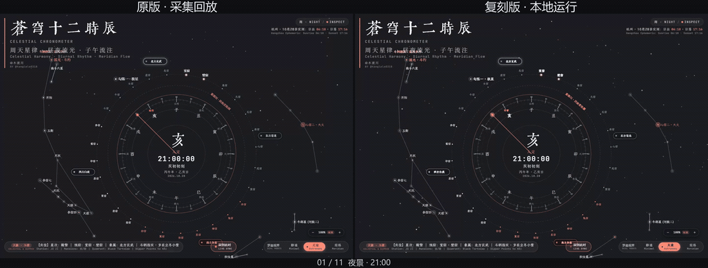
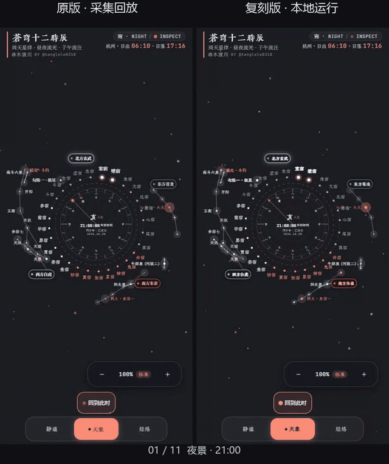

# Website Reproduction · 网站复刻

从网址、网页源码或 `DESIGN.md` 与素材包出发，复现约定页面的样式、响应式布局、交互和动效，交付可运行工程与对照记录。

[使用规范](SKILL.md) · [原创示例](examples/README.md) · [工具说明](references/tooling.md)

## 展示案例

### 苍穹十二时辰

[查看在线原站](https://celestial-shichen-clock.vercel.app/) · [案例说明](examples/showcases/shichen-clock.md)

以作者自己的时辰时钟为例，复用已有源码并将已取得的字体转为本地资源，保留昼夜流光、星空与罗盘动效、拖动调时、视界缩放和经络说明。桌面、手机与平板均经过实际操作验证。

**桌面录屏对比 · 左侧原版，右侧复刻版**

[查看高清桌面对比视频](assets/showcase/shichen-comparison-desktop.mp4)

**手机录屏对比 · 左侧原版，右侧复刻版**

[查看高清手机对比视频](assets/showcase/shichen-comparison-mobile.mp4)

两侧均为真实操作录屏：桌面采用 1440×1000 视口，手机采用 390×844 视口；按相同操作节点剪辑后左右合成，统一播放，便于观察样式、交互和动效。上方动图可直接播放，高清 MP4 保留完整视口。

本例为**自有源码本地化复刻**。左侧原版标注为「采集回放」：使用已取得的线上原始文件，原站外部字体冷加载未完整通过。字体、随机星空与绘制相位差异保留，不以剪辑对齐声称逐帧一致，[完整验证范围见案例说明](examples/showcases/shichen-clock.md#证据边界)。

## 复刻内容

### 页面与响应式

整理真实文案、字体颜色、尺寸间距和素材关系，分别核对桌面、平板与手机的布局。

### 交互与动效

检查菜单、弹层、选项切换、滚动和拖动等实际操作，记录动效的触发与时间参数。Canvas / WebGL 场景结合渲染状态和真实输入验证。

### 设计规范与素材包

将已有资料和补充证据整理为 `DESIGN.md`、实际素材与来源清单，保留缺项和未验证内容，便于实现、交接与复查。

## 如何使用

在支持 Skill 的工具中，将完整文件夹保存为 `website-reproduction`，按工具要求放入 Skills 目录，然后提供网址或本地材料，说明复刻范围：

> 使用 $website-reproduction，复刻我提供的网站首页，复用已有资料并补齐缺项，核对桌面和手机的样式、交互与动效，完成后打开本地页面。

也可以直接提供自有或获许可的源码，或已有的 `DESIGN.md` 与素材包。结果以实际取得的证据为准，未验证项会单独列出。

可选采集与校验脚本需要 Python 3.11+；依赖、浏览器配置和运行命令见[工具说明](references/tooling.md)。

## 授权与来源

核心方法来自作者持续维护的网站 `DESIGN.md` 规范，并结合实际复刻任务完善。来源、AI 辅助编写及依赖说明见 [ATTRIBUTION.md](ATTRIBUTION.md)。

本包采用 [MIT License](LICENSE)。第三方网站、源码、字体、图片等仍按各自授权使用，使用本 Skill 不会改变其权利归属。

[作者：木渡川（Tanglele）](https://x.com/tanglele0318)
