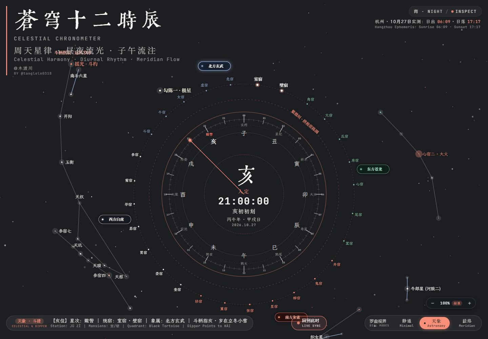
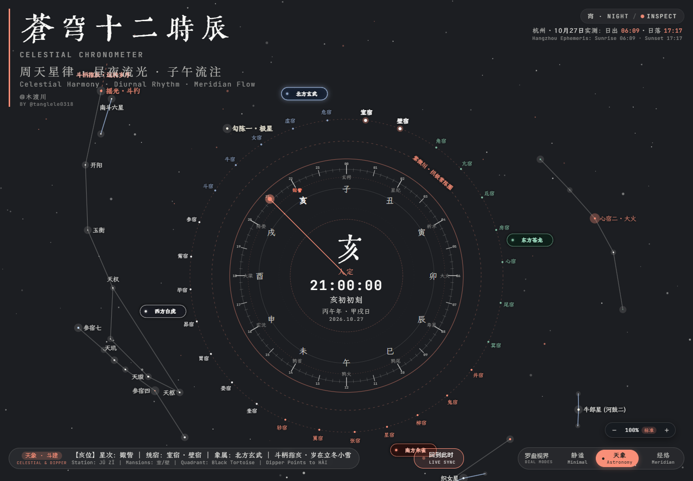
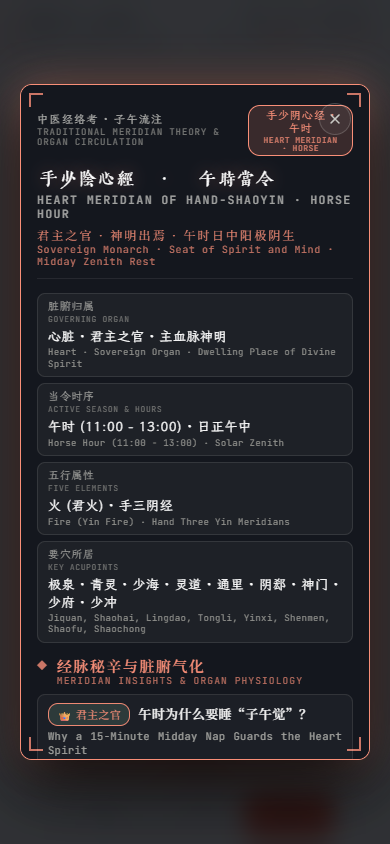

# 苍穹十二时辰

[在线原站](https://celestial-shichen-clock.vercel.app/) · 作者：[木渡川（Tanglele）](https://x.com/tanglele0318)

这是一个将十二时辰、星象和传统经络文化内容结合的交互时钟。案例展示 Website Reproduction 的已有资料复用、源码本地化、响应式与交互验收流程。

## 实现方式

复用作者原有工程。取得的线上 HTML、CSS、JavaScript 与齐伋字体，和作者本地原件逐一校验 SHA-256 一致。主样式与时钟逻辑保持原样；将成功取得的 45 个外部字体文件转为本地资源，移除未取得的 font-face 并保留原样式中的后备字体顺序。

这属于自有源码本地化，不是只凭截图独立重写。静态截图与原始验收记录取自 2026-10-27；左右对比录屏于 2026-10-28 分别重新录制。

## 实际验证

| 项目 | 结果 |
| --- | --- |
| 视口 | 桌面 1440×1000、平板 768×1024、手机 390×844；DPR 1 |
| 核心操作 | 三模式切换、地支选择、鼠标 / 触摸拖动调时、实时恢复、缩放按钮、桌面滚轮、手机双指捏合、弹窗打开 / 关闭 / Escape、键盘 Enter |
| 动效 | 星空 Canvas 连续变化，午时 / 夜间配色切换；保留原有组件动画 |
| 本地运行 | 仅允许本地 origin 的隔离冷加载；69 / 69 项检查通过，失败资源与未捕获 JavaScript 错误均为 0 |
| 对照 | 已取得原站字节隔离回放：66 / 66 项操作通过；18 个状态、1296 项布局和样式采样一致，几何容差 0.5px |

## 原版与复刻版录屏对比

两侧分别运行、分别录像，包含相同的 11 个操作阶段：夜景、切换午时、静谧、经络、打开说明、关闭说明、返回天象、缩至全貌、恢复标准、拖动调时和回到夜间。原始录像保持正常播放速度；按对应操作节点截取两侧共同长度，去掉较长一侧多出的等待，再合成一个左右并排的视频，保证统一开始、暂停和循环。

**桌面：左原版采集回放，右复刻版**

[高清桌面 MP4](../../assets/showcase/shichen-comparison-desktop.mp4)

**手机：左原版采集回放，右复刻版**

[高清手机 MP4](../../assets/showcase/shichen-comparison-mobile.mp4)

展示用 GIF 为录屏压缩版，MP4 保留两边完整视口，标签与分隔线位于原始画面之外。剪辑对齐只为方便观看，不代表原站与复刻版随机场景逐帧相同；两侧实际差异没有修图消除。

## 静态细节对照

左侧为线上文件采集回放，右侧为本地复刻；两侧分别运行、分别截图。桌面夜景采用相同的 1440×1000 视口、DPR 1 和 21:00 时刻，手机采用 390×844。

| 原版 · 线上文件采集回放 | 复刻版 · 本地运行 |
| --- | --- |
|  |  |

<table>
  <tr><th>原版 · 手机弹窗</th><th>复刻版 · 手机弹窗</th></tr>
  <tr>
    <td></td>
    <td></td>
  </tr>
</table>

展示图片直接复用验收原图，未裁切、改色或替换内容。完整本地交付附有三视口 × 六状态的 18 组对照，并可打开在线原站与实际本地页面继续操作。

## 证据边界

原站的外部字体服务存在 403/404、整包字体超过资源上限及超时；两次完整公网冷加载未完成。上表的原站对照采用已采集文件与相应缺失字体条件回放，没有把它标成公网完整验收。

本地页面使用已取得字体和原有后备字体，尚未证明所有字形、字重及弹窗长文在其他系统上一致。随机星空、动态日期与绘制相位不作逐帧像素等价断言。验证环境为 Chromium 的桌面和移动模拟；未验证真机、其他浏览器、真实定位或减少动态效果适配。

## 来源与许可

页面设计与自有源码来自木渡川（Tanglele）。本 Skill 包内仅包含展示截图、录屏衍生动图与此案例说明，不包含网站完整源码和第三方字体。字体仍按各自 OFL 许可使用；Skill 的 MIT 许可不会改变第三方资源的权利归属。
